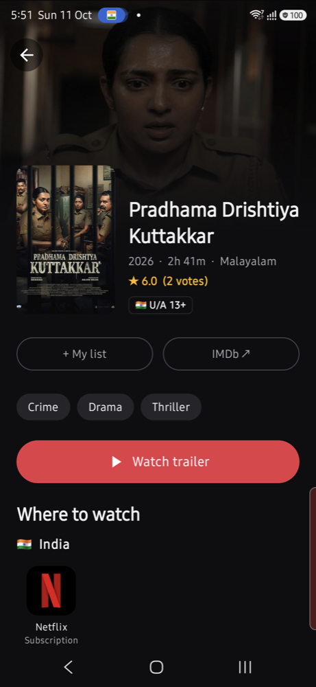
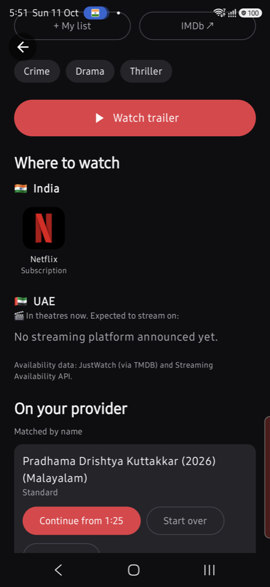
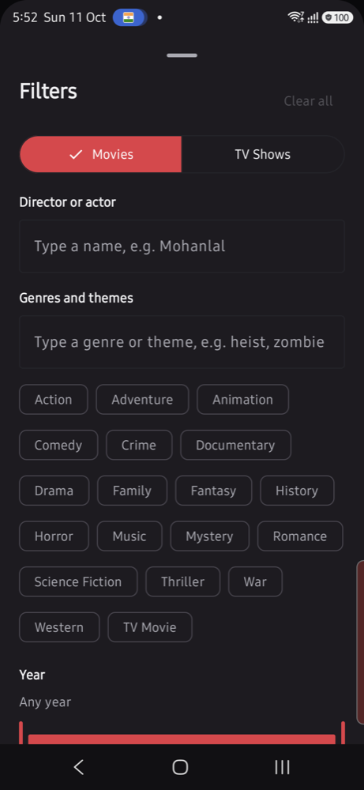
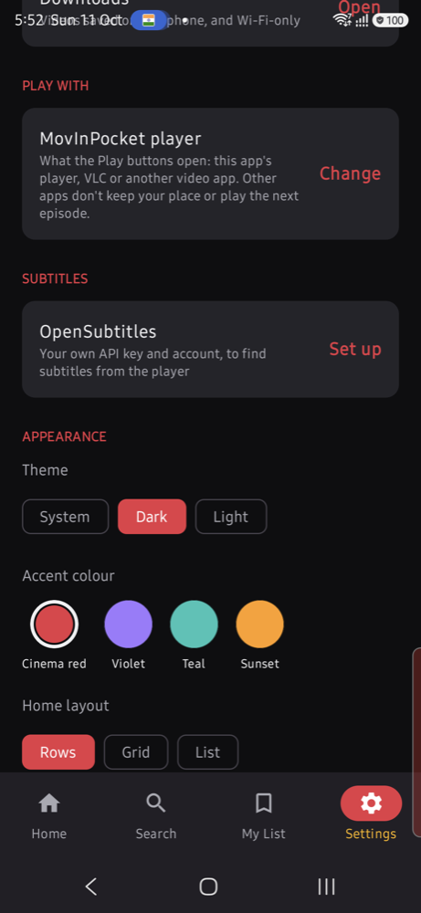
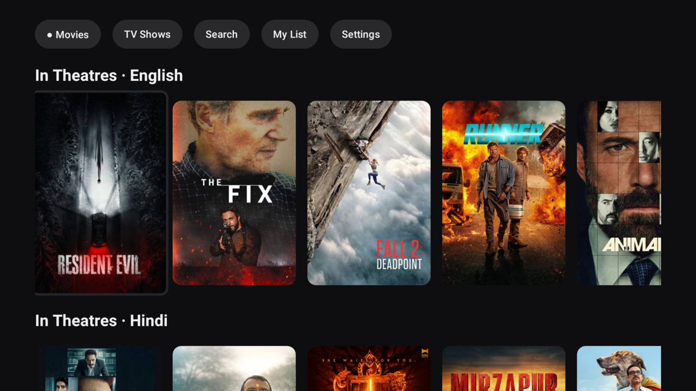
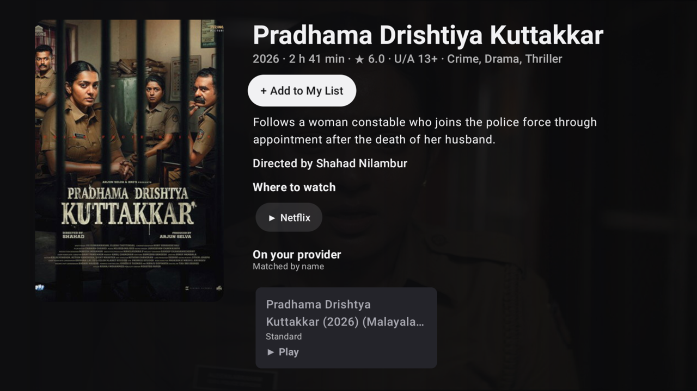
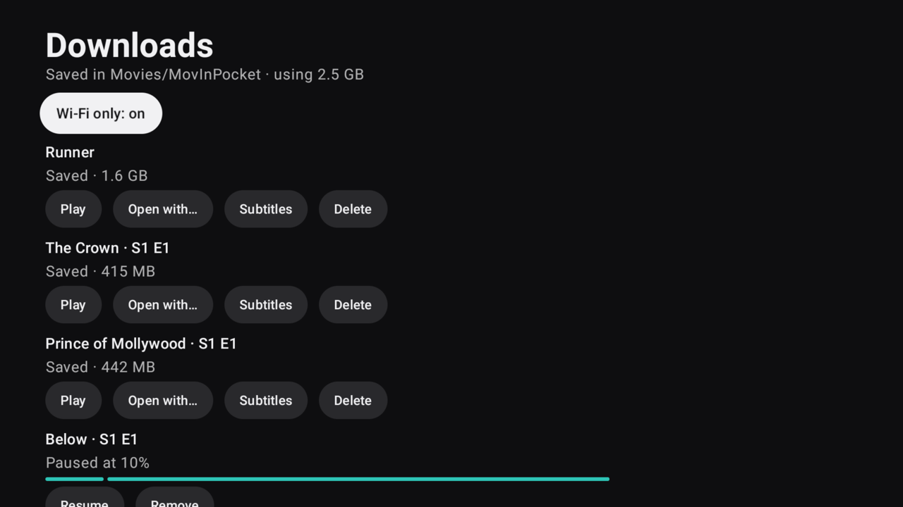
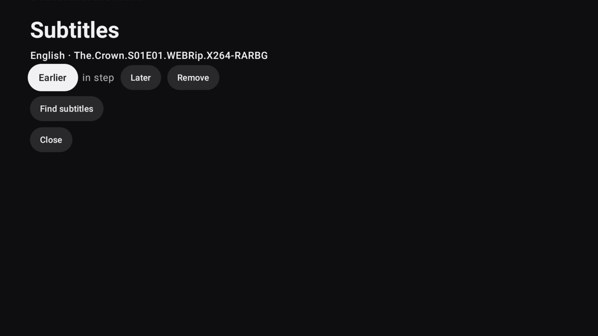

# MovInPocket 🍿

**What's new in movies and TV, where to watch it, and your own streaming library, on your phone and on your TV.**

MovInPocket is an Android app (Kotlin, Jetpack Compose) that shows what is **in theatres, coming soon, and new on streaming** for the countries and languages you choose, tells you **where to watch** each title, and opens it straight in the streaming app. If you have your own streaming provider login, it can also **play, download, cast and add subtitles** to what that provider offers, on a phone or on an Android TV / Google TV.

> **This repository is a showcase** (screenshots and a feature tour). The source code is not published here.
>
> Built as a learning project, together with [Claude Code](https://claude.com/claude-code): one small milestone at a time, each planned, built, tried on real devices and committed.

**Current version: 3.2** · Android 10+ · phone and Android TV / Google TV

---

## Screenshots

**On the phone** (Samsung Galaxy S25 Ultra):

| Title page | Where to watch and your provider | Advanced search | Settings |
|:---:|:---:|:---:|:---:|
|  |  |  |  |

**On a TV** (NVIDIA Shield, Android TV):

| Home | Title page |
|---|---|
|  |  |
| **Downloads** | **Subtitles** |
|  |  |

---

## Features

### Discover
- **Netflix-style Home:** an auto-rotating hero banner, a Movies / TV Shows switch, and one row per section and language: *In Theatres*, *New on Streaming*, *Coming Soon*, *Airing This Week*, *New Series*.
- **Your countries and languages:** pick several of each (16 countries, 16 languages). Regional films get their own rows, so English popularity doesn't bury a Malayalam release.
- **Switchable layouts:** rows, grid or list.
- **Fast and offline-friendly:** Home shows a saved copy first and refreshes in the background, with shimmer loading, pull-to-refresh and an offline notice.
- **Title pages:** backdrop, rating, runtime or seasons, genres, story, **director** (or a show's creators), cast, trailer, per-country theatre and streaming dates, **IMDb link** and **age ratings** for your countries.

### Where to watch
- Platform tiles per country (subscription, free, rent, buy).
- Opens the exact title inside the streaming app when a link is known, otherwise the app, otherwise the web. On a TV it starts the platform's **TV app**.

### Search
- Search titles, **actors and directors**, with paging.
- **Advanced search:** genre (with typed genres and themes), year range, language, director or actor, rating, minimum votes, streaming platform, and sort order.

### My List and reminders
- Save titles to **My List** (kept on the device).
- **Release reminders:** a daily check tells you when a saved title opens in theatres, starts streaming, or has a new episode.

### Your own streaming provider *(optional)*
MovInPocket ships **no content and no provider**. If you have an Xtream Codes login from a provider you subscribe to, you enter it yourself (stored encrypted on the device).
- **Matching:** your provider's list is matched to TMDB titles by name, year and sequel number, with a "Wrong match?" fix when it guesses wrong. It prefers a missing match over a wrong one.
- **Play** movies and whole seasons, with **resume**, "Continue", watched marks, and next-episode.
- **Several copies** of one title (languages, qualities) are listed, each with its own Play.

### Downloads
- **Download a movie or an episode** to the device's `Movies/MovInPocket` folder, with a progress notification, **pause and resume** (a download carries on from where it stopped, even after the app is closed), and **Wi-Fi only** by default.
- Downloaded videos **play from the device**, even offline, and show in your gallery and file manager.
- A Downloads list with progress, space used, Play, Open with…, Subtitles and Delete.

### Subtitles
- Find and download subtitles from **OpenSubtitles** (you use your own free account and API key), in the languages you choose (English and Malayalam by default).
- Subtitles are **saved with the title or episode**, work offline, and show in the built-in player with an **Earlier / Later** timing control.
- Each downloaded video gets a subtitle file **next to it**, so VLC and other players show it by themselves.

### Play with the player you like
- A **"Play with"** setting: the built-in player, **VLC**, **MX Player**, any installed video app, or Android's chooser.
- Saved videos are handed over as a file with permission for that one file; streams after a one-time notice.

### Cast to your TV
- **Google Cast** (Chromecast, NVIDIA Shield, Google TV) and **DLNA** (LG and many others), with the phone as the remote: play, pause, seek, next episode.
- Resume, watched marks and the playlist keep working while casting.

### Android TV and Google TV
A full second interface built for the remote control, in the same app:
- Home, title pages, Search, My List, Settings, region setup and the player, all driven by the D-pad, with careful focus (the first poster on launch, the same poster after you come back).
- **Play, Download and Subtitles** work on the TV too, as does opening the streaming apps from "Where to watch".
- Light and dark themes with four accent colours.

### Look and feel
Dark, light or system theme, four accent colours, a custom adaptive icon, predictive back animations.

---

## Release history

| Version | Date | What it brought |
|---|---|---|
| **3.2** | 2026-10-11 | **Android TV app** (Home, title pages, Search, My List, Settings, region setup, player, downloads), **opening streaming apps** from the TV, **"Play with"** other players (VLC, MX Player…), **subtitles** (OpenSubtitles, timing control, a copy beside each download), the **director** on title pages, readable Light-mode TV buttons |
| **3.1** | 2026-10-11 | **Offline downloads**: pause and resume, Wi-Fi only, saved to `Movies/MovInPocket`, played offline; minimum Android raised to 10 |
| **3.0** | 2026-10-10 | **Advanced search**, **streaming provider login and matching**, **playback from the provider** with resume, **casting** to Google Cast and DLNA TVs (seeking works on the LG) |
| **2.0** | 2026-10-04 | Switchable layouts, search with people, **My List**, bottom navigation, **release reminders**, **Home caching**, IMDb link and age ratings |
| **1.0** | 2026-10-04 | The first release: onboarding, Netflix-style Home, title pages, **Where to watch**, settings and themes |

---

## Under the hood

| | |
|---|---|
| **Language and UI** | Kotlin 2.4, Jetpack Compose (BOM 2026.09), Material 3, Compose for TV (`androidx.tv`) |
| **Architecture** | MVVM with manual dependency injection, state hoisted into sealed UI states, `XScreen` + `XContent` split so every screen is previewable and testable |
| **Navigation** | Navigation Compose 2.10 with type-safe routes; the TV app reuses the phone's routes and ViewModels |
| **Data** | Retrofit 3 + kotlinx.serialization, OkHttp 5, Coil 3, Paging 3, **Room 2.8** (7 schema versions with auto-migrations), DataStore |
| **Playback** | **Media3 1.11** (ExoPlayer, `PlayerView`), Google Cast SDK 22, a hand-written **DLNA/UPnP** controller (SSDP discovery, SOAP, DIDL-Lite) |
| **Background work** | WorkManager (reminders, a resumable foreground download worker) |
| **Security** | Android Keystore AES-GCM for the provider and subtitle logins; their files are excluded from backups; stream links are never logged or shown |
| **Quality** | ≈18,500 lines of Kotlin, **448 unit tests** (fakes, virtual time, in-process fake servers), lint with zero errors, a minified release build checked on a phone and an NVIDIA Shield before each release |

Data sources: [TMDB](https://www.themoviedb.org/) (titles, credits), JustWatch via TMDB and the [Streaming Availability API](https://www.movieofthenight.com/about/api) (where to watch), [OpenSubtitles](https://www.opensubtitles.com/) (subtitles), and **your own provider** for playback.

---

## Known limits

- **Other players don't report back.** After watching in VLC or MX Player, "Continue" and "Watched" don't update and the next episode doesn't start by itself. The built-in player does all of that.
- **Samsung QLED TV from 2018 (Q6):** casting to it doesn't work. It rejects the provider's link, and the only fix found (relaying through the phone) needs the phone awake for the whole film, so it was dropped. Apple TV can't be targeted by an Android app.
- **Subtitles:** need your own OpenSubtitles key and account, free accounts have a daily download allowance, Malayalam is thinly covered, and a subtitle may need the Earlier / Later control to line up with your copy.
- **Streaming apps on a TV** open the app, and the exact title only when the app supports it.
- **Android 10 or newer** is required (downloads use the shared `Movies` folder).

---

## A note on content

MovInPocket **does not include, host, supply or recommend any streaming content or provider.** The streaming features only work with a provider login you enter yourself, and they play only what *your own* subscription gives you. Use them only for content you are entitled to watch.

## Attribution

This product uses the TMDB API but is not endorsed or certified by TMDB. Streaming availability comes from JustWatch (via TMDB) and the Streaming Availability API (Movie of the Night). Subtitles come from OpenSubtitles through its public API. Poster and backdrop images shown in the screenshots belong to their owners and are provided by TMDB. Platform names (Netflix, Prime Video, JioHotstar and others), VLC, MX Player and Google Cast are trademarks of their owners and are used here only to identify the apps the program opens.

© 2026 kerloy. All rights reserved. The app's source code is not published, and nothing in this repository grants permission to copy or reuse it.
